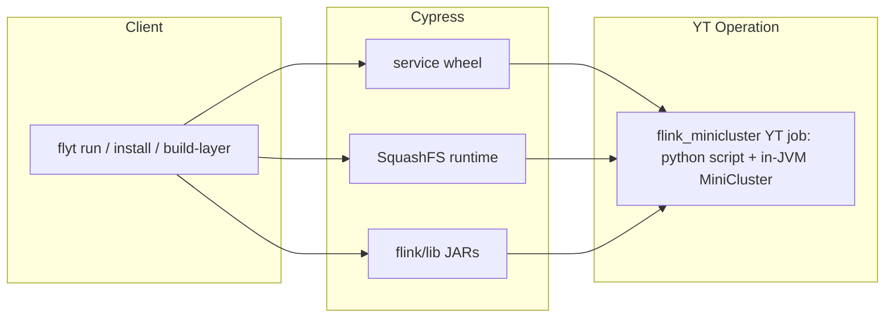
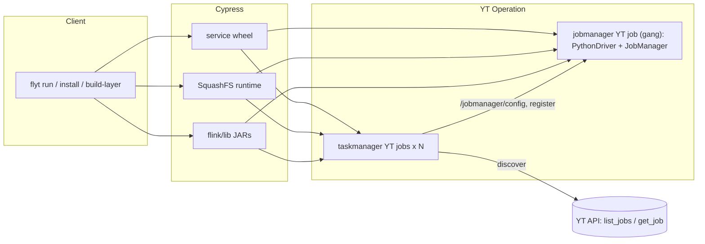
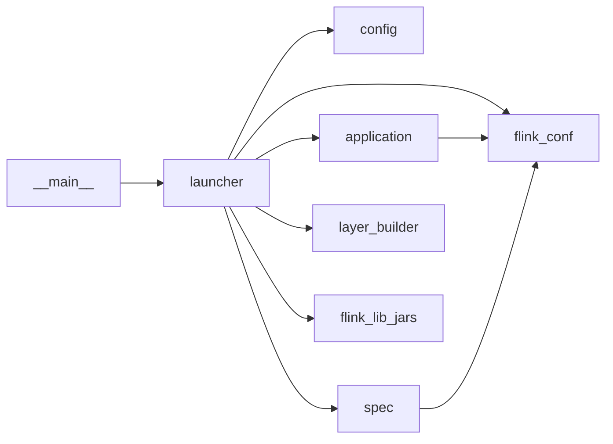

# Architecture

FLYT submits a PyFlink job as a YTsaurus Vanilla operation: one operation per pipeline, no shared cluster. The process builds an [operation spec](https://ytsaurus.tech/docs/ru/user-guide/data-processing/operations/vanilla#primer-specifikacii), uploads service wheels and JARs, and submits it via the YTsaurus client.

Two topologies (`cluster_mode`):

* `minicluster`: a single `flink_minicluster` task; the YT job runs `python <script>` and PyFlink starts an in-JVM MiniCluster. Heap comes from `FLINK_ENV_JAVA_OPTS` (preset); when the script exits 0 the operation completes.
* `application`: a `jobmanager` task (one gang YT job) and a `taskmanager` task (`taskmanager_count` YT jobs). The JobManager YT job runs `standalone-job.sh --job-classname org.apache.flink.client.python.PythonDriver -py <script>`, i.e. Flink application mode with the PyFlink driver next to the JobManager JVM. The user guide is [docs/application-mode.md](docs/application-mode.md); the mechanics follow.

## Operation layout

#### minicluster
One YT job, PyFlink starts the MiniCluster inside the script's JVM.

#### application
A gang JobManager YT job plus N TaskManager YT jobs that find it through the YT API.

## Application mode internals

#### YT resources
Resources are decided at submit time: `taskmanager_count` becomes the TaskManager YT job count, `jobmanager_cpu`/`taskmanager_cpu` (default: one per slot) the cpu limits, and the JVM sizes from the merged Flink configuration (`*.memory.process.size`, plus a fixed overhead for the non-JVM processes) the memory limits.

#### Configuration
The cluster configuration is one `config.yaml` built from three layers (flyt defaults, then a Flink `config.yaml` the profile points to with `base_flink_conf_path`, then `flink_config_override` from the profile) and written into every YT job, the way Flink on Kubernetes ships one ConfigMap to every pod. Only per-container values travel on the command line: the JobManager's addresses, the TaskManager's host and resource id, and the discovered JobManager endpoint.

#### Discovery
TaskManagers find the JobManager through the YT API instead of a registry: `taskmanager` YT jobs lists the running `jobmanager` YT job of the same operation and incarnation, reads its addresses from YT, confirms through Flink's `/jobmanager/config` that the REST port belongs to that job (`flyt.yt.job-id`), and starts `taskmanager.sh` against the advertised RPC endpoint.

#### Lifecycle
The JobManager is a gang YT job, so its failure restarts the whole cluster with a new incarnation, while a TaskManager is restarted alone and the Flink job recovers through Flink's restart strategy. When the driver exits 0 (bounded sources, cancel or stop from the Web UI) the JobManager YT job completes the operation, so the operation ends instead of leaving TaskManagers waiting; a TaskManager that times out in discovery fails too, which eventually fails an operation whose JobManager never gets scheduled.

## Runtime and delivery

#### Profiles
Profiles encapsulate cluster proxy/pool, paths, layers, etc.; every profile key is a field of the launch configuration.

#### SquashFS runtime
The SquashFS runtime is built where you run `flyt` (Docker/Podman + `mksquashfs`), keyed by hash and cached on Cypress so exec nodes do not run `pip` per YT job. 

#### Delivery to YT jobs
[`layer_paths`](https://ytsaurus.tech/docs/en/user-guide/data-processing/operations/operations-options#user-script-options) — for production clusters (mount SquashFS on the node) — or `sandbox_unpack` — for local (Kind) clusters where porto support is not available (upload `.squashfs` as a file and unpack in the sandbox). 

#### Service wheel
Wheels in the layer target `runtime_python_version`; `python_bin` on workers must match that ABI.

#### JARs
List basenames in `embed_squashfs_layer_jar_basenames` (inside the layer) and/or `runtime_jar_basenames` (staged as [`file_paths`](https://ytsaurus.tech/docs/en/user-guide/data-processing/operations/operations-options#user-script-options) to `flink/lib`). Resolution picks the latest semver per basename under `jar_scan_folder`.

## Code layout

The code is split so the CLI, YTsaurus submission, and layer/image build logic can be tested independently. YT job bootstrap is concatenated bash from `run_scripts/`: `common/` prepares the sandbox for every role, then `minicluster/run.sh` or the `application/` fragments with one entry script per role (`jobmanager.sh`, `taskmanager.sh`). `flink_conf` owns the application cluster's Flink `config.yaml`: reading `base_flink_conf_path`, merging the layers, flyt's defaults and warnings (minicluster jobs get none: the script configures its MiniCluster in code). `application` resolves the application cluster from it: the YT resources of the JobManager and TaskManagers and their shared configuration.

